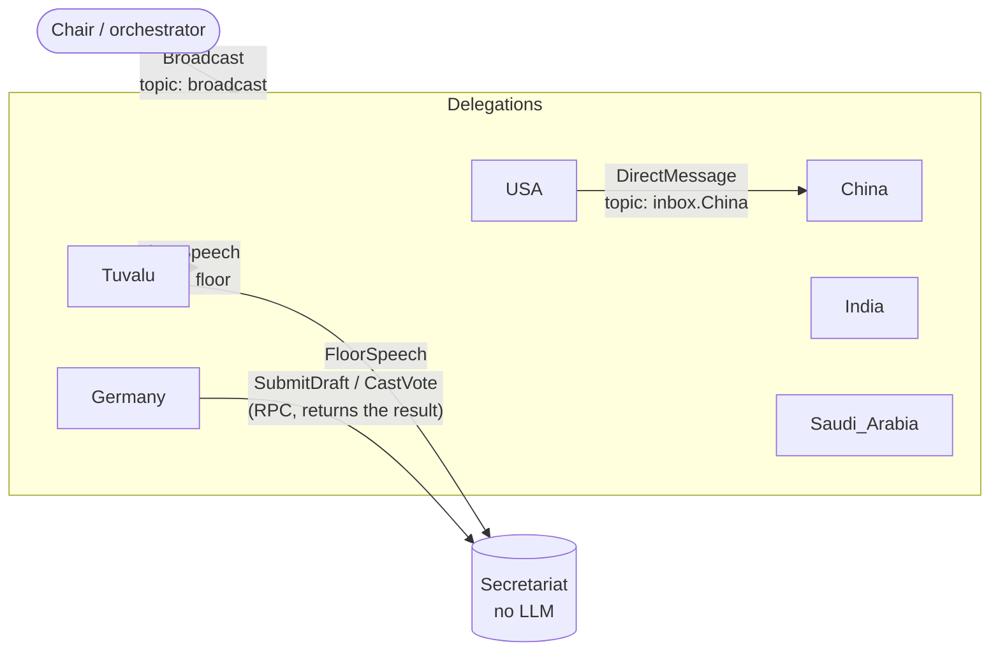

# simpact

## Nested climate negotiation / agent dynamics lab

The climate experiment has six delegations with three members each: head
negotiator, economic minister and climate adviser. Inspect each member's position,
each round's private team discussion and mandate support, then test member-to-member
or group meeting requests with a five-tick acknowledgement deadline.

```bash
uv sync
uv run python -m climate_sim --seed 42 --output runs/my-climate-run
uv run python -m climate_sim.lab --run runs/my-climate-run --port 8766
```

Open `http://127.0.0.1:8766/`. This is a local researcher replay and a manual meeting
protocol sandbox, not a live multi-user summit. Set `GEMINI_API_KEY` locally and add
`--backend gemini` to generate LLM agent runs. Offline policies and the mock climate
evaluator are explicitly labelled; private archives are not public summit data.

See [the agent lab guide](docs/agent_lab.md) for information boundaries, member/human
controllers, meeting protocol details and the remaining live-integration work.

## Original Model UN simulator

A Model UN simulation with LLM agents. Each country delegation is an autonomous agent with its own persona, private objectives, memory and tools. Delegations give speeches, negotiate privately one to one, draft resolutions and vote, while a Chair (the orchestrator) moves the session through its phases with broadcasts.

Built on [AutoGen Core](https://microsoft.github.io/autogen/stable/user-guide/core-user-guide/index.html), the event-driven runtime from Microsoft AutoGen, with Gemini as the model.

## Quickstart

Requires [uv](https://docs.astral.sh/uv/) and a Gemini API key.

```bash
uv sync
export GEMINI_API_KEY=...
uv run model_un.py                 # full session: 5 phases, 6 delegations
uv run model_un.py --phases 2      # only opening statements and the caucus
uv run model_un.py --scenario scenarios/my_topic.toml
GEMINI_MODEL=gemini-3.8-flash uv run model_un.py   # default: gemini-flash-latest
python check_scenario.py           # validate scenarios/*.toml before spending model calls
```

The console shows speeches, private messages, notes, drafts and votes as they happen, then the vote results.

## A session

The default scenario, [`scenarios/loss_and_damage.toml`](scenarios/loss_and_damage.toml), has the USA, China, India, Germany, Saudi Arabia and Tuvalu negotiating who pays into the UN Loss and Damage Fund. The Chair runs five phases. Each phase is one broadcast, and the phase ends when every agent has gone quiet.

| Phase | What delegations do |
|---|---|
| Opening statements | Look up facts with `web_search`, give a speech with `speak_to_floor` |
| Unmoderated caucus | Negotiate privately with `send_message`, build coalitions, save promises with `remember` |
| Drafting | One member per coalition submits a resolution with `submit_draft`, naming its co-sponsors |
| Debate on drafts | Speak for or against drafts, negotiate amendments; sponsors may resubmit |
| Voting procedure | `cast_vote` yes / no / abstain on every draft; a draft is adopted when yes > no |

## How it works



Everything is an agent on one AutoGen Core runtime, and agents talk only through messages:

| Message | Route | What triggers |
|---|---|---|
| `Broadcast` | `broadcast` topic, every delegation subscribes | Each delegation thinks and acts (LLM call) |
| `DirectMessage` | `inbox.<name>` topic, only that delegation subscribes | The recipient thinks and may reply |
| `FloorSpeech` | `floor` topic, everyone subscribes | Nothing: the speech is added to each listener's prompt context. No LLM call, so speeches stay cheap. |
| `SubmitDraft`, `CastVote` | RPC to the Secretariat | The Secretariat records it and returns a draft ID or confirmation to the tool call |

**A delegation** (`Delegate` in [`model_un.py`](model_un.py), built on `PersonaAgent` in [`swarm.py`](swarm.py)) has:

- **Persona.** Name, public position, private objectives, red lines and negotiating style, all from the scenario file. Other delegations see only the public position, through the agent index.
- **Memory.** The last 30 messages of its own conversation, plus long-term notes it writes with `remember`. Both go into every prompt.
- **Tools.** `send_message`, `list_agents`, `remember`, `web_search` (Google Search grounding through Gemini), `speak_to_floor`, `submit_draft` and `cast_vote`.
- **Think loop.** On every incoming broadcast or private message it calls the LLM and runs the tools it asks for, repeating until the model answers with plain text (its private thought) or 6 rounds have passed.

**The Secretariat** is plain code with no LLM. It holds the official record of speeches, drafts and votes, so the results don't depend on what agents remember.

**Guardrails for long runs:**

- **One message at a time.** Each agent handles its inbox in order, behind a lock.
- **Reply-chain cap.** A chain of private replies stops after `max_hops` (default 4) until the next phase.
- **Failed LLM calls.** The error is logged on one line and the agent carries on.

## Output

Each run writes to `runs/<timestamp>/`:

- `events.jsonl`: every message on the bus, recorded by `TranscriptRecorder`, an AutoGen intervention handler that sees all traffic without the agents knowing.
- `state.json`: each delegation's conversation history and notes, plus the Secretariat's record (speeches, drafts, votes, results).

## Writing a scenario

Copy `scenarios/loss_and_damage.toml` and edit it:

```toml
committee = "UN Security Council"
agenda = "..."
max_hops = 4

[[delegations]]
name = "France"                 # agent id: letters, digits, underscores
title = "the delegation of France"
public_position = "..."         # visible to every delegation
objectives = "..."              # private
red_lines = "..."               # private
style = "..."                   # private

[[phases]]
name = "Opening statements"
instruction = "... {agenda} ... {committee} ... {drafts} ..."   # what the Chair broadcasts
```

Phases run in order. `{drafts}` is filled with the Secretariat's current draft resolutions, which is how the voting phase sees the final texts.

## Code layout

| File | Contents |
|---|---|
| [`swarm.py`](swarm.py) | Scenario-independent layer: message types, agent index (`Directory`), `PersonaAgent` (memory, tools, think loop, save/load state), `register_persona`, `TranscriptRecorder` |
| [`gemini.py`](gemini.py) | Gemini chat client for AutoGen and the `web_search` tool |
| [`model_un.py`](model_un.py) | The Model UN scenario: committee messages, `Secretariat`, `Delegate`, and the session loop |
| [`scenarios/`](scenarios) | Scenario files |

To extend:

- **New tool for delegations:** add a method to `Delegate` and list it in `extra_tools()`.
- **New kind of event:** add a dataclass and a `@message_handler` on the agents that should receive it.
- **Other LLM:** pass any AutoGen `ChatCompletionClient`, such as the OpenAI or Anthropic clients in `autogen-ext`.

## Known caveats

- **AutoGen is in maintenance mode.** `autogen-core` 0.7.5 (September 2025) is the last feature release, and Microsoft points new projects to Microsoft Agent Framework. Agent Framework routes messages only along edges fixed when its workflow graph is built, which doesn't suit free one-to-one messaging plus broadcast, so this project stays on AutoGen Core.
- **Gemini 3 thought signatures.** Gemini 3 models return a thought signature with each tool call and reject the next request if it isn't sent back. `autogen-ext` 0.7.5 drops it, so `gemini.py` patches the client to keep it. Remove the patch if you switch to a client that handles signatures itself.
- **Agents' memories can drift.** What a delegation remembers is LLM-written and may contradict what was agreed. The Secretariat's record is the source of truth for drafts and votes.
- **Cost grows with chattiness.** Private messages make each delegation think again, so 6 delegations can produce hundreds of LLM calls per session. Lower `max_hops` or the number of delegations to cut cost. `web_search` uses Gemini's Google Search grounding, which has its own quota.
- **Resuming isn't wired up.** `runtime.save_state()` is written at the end, and delegations can reload it with `load_state`, but the Secretariat can't reload its record yet.
