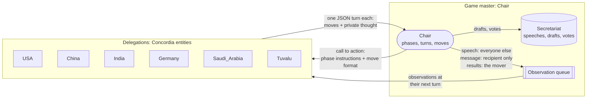

# simpact

## Nested climate negotiation / agent dynamics lab

The climate experiment has six delegations with three members each: head
negotiator, economic minister and climate adviser. Inspect each member's position,
each round's private team discussion and mandate support, then test member-to-member
or group meeting requests with a five-tick acknowledgement deadline.

```bash
uv sync
uv run python -m climate_sim --seed 42 --output runs/my-climate-run
uv run python -m climate_sim.lab --run runs/my-climate-run --port 8766
```

Open `http://127.0.0.1:8766/`. This is a local researcher replay and a manual meeting
protocol sandbox, not a live multi-user summit. Set `GEMINI_API_KEY` locally and add
`--backend gemini` to generate LLM agent runs. Offline policies and the mock climate
evaluator are explicitly labelled; private archives are not public summit data.

See [the agent lab guide](docs/agent_lab.md) for information boundaries, member/human
controllers, meeting protocol details and the remaining live-integration work.

## Original Model UN simulator

A Model UN simulation with LLM agents. Each country delegation is an autonomous agent with its own persona, private objectives, memory and tools. Delegations give speeches, negotiate privately one to one, draft resolutions and vote, while a Chair moves the session through its phases.

Built on [Concordia](https://github.com/google-deepmind/concordia), Google DeepMind's library for generative agent-based simulations, with Gemini 3.8 Flash as the model.

## Quickstart

Requires [uv](https://docs.astral.sh/uv/) and a Gemini API key.

```bash
uv sync
export GEMINI_API_KEY=...
uv run model_un.py                 # full session: 5 phases, 6 delegations
uv run model_un.py --phases 2      # only opening statements and the caucus
uv run model_un.py --scenario scenarios/my_topic.toml
uv run model_un.py --resume runs/<timestamp>/state.json   # continue a run after its last completed round
uv run model_un.py --verbose       # also print Concordia's step-by-step engine trace
uv run python check_scenario.py    # validate scenarios/*.toml before spending model calls
```

The console shows speeches, private messages, tool calls, drafts and votes as they happen, then the vote results.

## A session

The default scenario, [`scenarios/loss_and_damage.toml`](scenarios/loss_and_damage.toml), has the USA, China, India, Germany, Saudi Arabia and Tuvalu negotiating who pays into the UN Loss and Damage Fund. The Chair runs five phases. Each phase opens with every delegation acting, and ends when every delegation has gone quiet.

| Phase | What delegations do |
|---|---|
| Opening statements | Look up facts with `web_search`, give a speech with `speak_to_floor` |
| Unmoderated caucus | Negotiate privately with `send_message`, build coalitions, save promises with `remember` |
| Drafting | One member per coalition submits a resolution with `submit_draft`, naming its co-sponsors |
| Debate on drafts | Speak for or against drafts, negotiate amendments; sponsors may resubmit |
| Voting procedure | `cast_vote` yes / no / abstain on every draft; a draft is adopted when yes > no |

## How it works



Concordia splits a simulation into **entities**, which observe and act, and a **game master**, which decides who acts, tells them what they may do, and works out what their actions cause. Entities never hold references to each other: everything they learn reaches them as an observation from the game master.

Each step of Concordia's simultaneous engine is one round:

1. The Chair names the delegations due this round. A phase opens with everyone; after that, only delegations that received a private message act again.
2. Each of them reads its queued observations, then answers the Chair's call to action in parallel. The call to action carries the phase instructions and the list of moves.
3. The Chair carries out every move in a fixed delegation order, records drafts and votes with the Secretariat, and queues observations for whoever should see them.

| Move | Who observes it | What else happens |
|---|---|---|
| `speak_to_floor` | Every other delegation | The Secretariat records the speech |
| `send_message` | Only the recipient | The recipient acts again next round |
| `submit_draft` | Only the sponsor, with the Secretariat's reply | Registered as `L.1`, `L.2`... A resubmission replaces the sponsor's draft |
| `cast_vote` | Only the voter, with the Secretariat's reply | Counted in the results |

Every delegation is also told what its own moves did and what it thought, so its history includes its own side of each conversation.

**A delegation** (the `PersonaAgent` prefab in [`swarm.py`](swarm.py)) is a Concordia entity built from components:

- **Persona.** Name, public position, private objectives, red lines and negotiating style, all from the scenario file. Other delegations see only the public position, through the directory in every prompt.
- **Memory.** Its last 50 observations (Concordia's `LastNObservations` over an `AssociativeMemory`), plus long-term notes it writes with `remember`. Both go into every prompt.
- **Tools.** `web_search` (Google Search grounding through Gemini) and `remember`. The model can call them before it answers, through Concordia's `InteractiveDocumentWithTools`, up to 5 calls per turn.
- **Moves.** Its answer is one JSON object, `{"moves": [...], "thought": "..."}`. The thought is private: the Chair logs it and echoes it back to the delegation only.

**The Chair and the Secretariat** (in [`model_un.py`](model_un.py)) are plain code with no LLM. The Chair is one component answering the engine's four questions: is the session over, who acts next, in what format, and what did the moves cause. The Secretariat holds the official record of speeches, drafts and votes, so the results don't depend on what agents remember. Observations go through Concordia's `MakeObservation` queue with its LLM fallback turned off, so nobody observes anything the Chair didn't send them.

**Guardrails for long runs:**

- **One turn per round.** Each delegation acts at most once per round, and all of a round's moves are resolved together.
- **Reply-chain cap.** After `max_hops` (default 4) rounds of replies, private messages are refused until the next phase.
- **Failed LLM calls.** Each call is retried with backoff. If it still fails, the error is logged on one line and the delegation sits that round out.
- **Unreadable answers.** If a turn isn't valid JSON, nothing happens, and the delegation is told why at its next turn.

## Output

Each run writes to `runs/<timestamp>/`:

- `events.jsonl`: every phase and move as the Chair carried it out, including refused moves and the Secretariat's replies.
- `state.json`: Concordia's checkpoint of every component, rewritten after each round. That covers each delegation's memories and notes, the Secretariat's record (speeches, drafts, votes, results), the Chair's place in the agenda and undelivered observations. `--resume` continues from it.
- `log.html`: Concordia's log viewer, with every prompt and answer step by step, and each delegation's memories.

## Writing a scenario

Copy `scenarios/loss_and_damage.toml` and edit it:

```toml
committee = "UN Security Council"
agenda = "..."
max_hops = 4

[[delegations]]
name = "France"                 # entity name: letters, digits, underscores
title = "the delegation of France"
public_position = "..."         # visible to every delegation
objectives = "..."              # private
red_lines = "..."               # private
style = "..."                   # private

[[phases]]
name = "Opening statements"
instruction = "... {agenda} ... {committee} ... {drafts} ..."   # what the Chair asks delegations to do
```

Phases run in order. `{drafts}` is filled with the Secretariat's current draft resolutions, which is how the voting phase sees the final texts.

## Code layout

| File | Contents |
|---|---|
| [`swarm.py`](swarm.py) | Scenario-independent layer: `FunctionTool` (a Python function as a Concordia tool), `Notes` (the `remember` component), `ToolUseAct` (the act component with the tool loop), and the `PersonaAgent` prefab |
| [`gemini.py`](gemini.py) | Concordia's Gemini model with retries, pinned to `gemini-3.8-flash`, and the `web_search` function |
| [`model_un.py`](model_un.py) | The Model UN scenario: `Secretariat`, `Chair`, the `ChairGameMaster` prefab, and the session runner |
| [`scenarios/`](scenarios) | Scenario files |
| [`data/climate/`](data/climate) | Original World Climate Simulation briefings and facilitator guide (not used by the simulation yet) |

To extend:

- **New move:** add a line to `MOVES` and a `case` to `Chair._play_move` in `model_un.py`.
- **New tool for delegations:** wrap a function in `FunctionTool`, with a description that names its arguments, and add it to the `tools` param.
- **Other LLM:** return any Concordia `LanguageModel` from `gemini_model()`, such as the OpenAI or Ollama wrappers in `concordia.contrib.language_models`.

## Known caveats

- **Tools and moves are JSON in plain text.** Concordia's language model interface is text in, text out, without native function calling. A malformed answer costs the delegation its turn, though it is told why.
- **Agents' memories can drift.** What a delegation remembers is LLM-written and may contradict what was agreed. The Secretariat's record is the source of truth for drafts and votes.
- **Cost grows with chattiness.** Every private message makes its recipient act again, and each turn can add up to 5 tool calls. Lower `max_hops` or the number of delegations to cut cost. `web_search` uses Gemini's Google Search grounding, which has its own quota.
- **Concordia is pinned to 2.4.0** (March 2026), the latest PyPI release. GitHub `main` has moved on and changes several of the APIs used here.
- **Resumed runs restart step numbers** in `log.html`, because each run of the engine counts its own steps.
